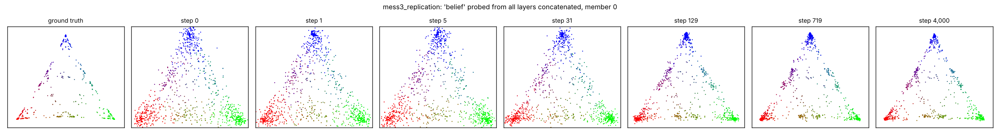
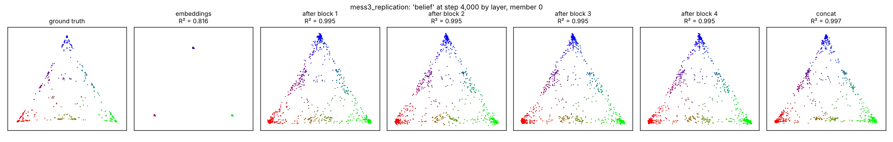
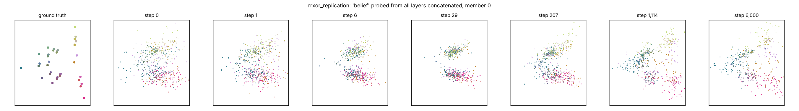
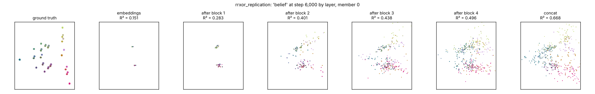
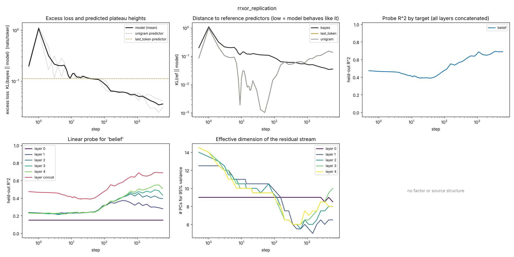
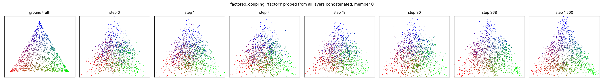
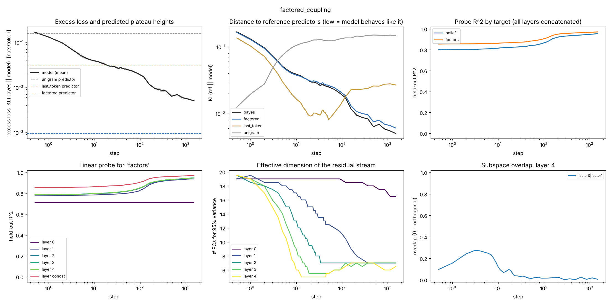

# Example plots

These figures come from **short test runs on a small 2-core CPU machine** (a few thousand steps, small models, 2 seeds), made while developing the code. They show what each plotting command produces. **They are not results.** None of these models was trained to convergence, and the full-length configs in `configs/` are what the experiments should use.

Geometry plots show seed (member) 0 on held-out probe points. Dashboards average over seeds, with individual seeds drawn faintly in the excess-loss panel.

## Mess3

Trained with:

```bash
python -m bsg.train configs/mess3_replication.yaml --set train.steps=4000 train.n_seeds=2 train.optimizer=adam train.lr=2e-3 eval.n_sequences=2048 eval.per_decade=8
```

The published setup uses SGD for 1,000,000 steps. Adam was used here only to get a visible result within a couple of minutes.

**Belief geometry over training, all layers concatenated** (`python -m bsg.plot geometry RUN --target belief`). The fractal of the Mess3 belief simplex sharpens over training. Colours are the true belief, read as RGB.



**Final checkpoint, layer by layer** (`python -m bsg.plot layers RUN --target belief`). The embeddings only encode the last token: points collapse to three clusters. After the first block, every layer already carries the geometry (R² ≈ 0.995). Mess3 has no next-token degeneracies, so the geometry survives to the final layer.



## RRXOR

Trained with:

```bash
python -m bsg.train configs/rrxor_replication.yaml --set train.steps=6000 train.n_seeds=2 train.optimizer=adam train.lr=2e-3 eval.n_sequences=1024 eval.per_decade=8
```

RRXOR's 36 belief states live in a 4-simplex; plots show the top two principal components of the true beliefs, coloured by the true belief.

**Belief geometry over training, all layers concatenated.**



**Final checkpoint, layer by layer.** The model is only partly trained (excess loss ≈ 0.04 nats/token). Even so, the concatenation of all layers recovers more of the geometry (R² ≈ 0.67) than any single layer (0.15–0.50). This is the pattern Shai et al. (2024) reported for RRXOR, where distinct belief states share a next-token distribution and the final layer need not keep them apart.



**Dashboard** (`python -m bsg.plot curves RUN`). Panels:

1. Excess loss, with the predicted plateau height of each reference predictor as a dashed line.
2. KL divergence to each reference predictor; low means the model behaves like it.
3. Probe R² by target, all layers concatenated.
4. Probe R² per layer.
5. Effective dimension of each layer's residual stream.
6. Subspace overlap between factors or sources (empty here: RRXOR has neither).

RRXOR has zero pairwise correlation, so the last-token predictor equals the unigram predictor and their curves coincide in panel 2. Around steps 10–100 the model sits close to them, then moves away as it starts using longer context.



## Two Mess3 factors with a hidden-state coupling

Trained with a reduced model:

```bash
python -m bsg.train configs/factored_coupling.yaml --set train.steps=1500 train.n_seeds=2 data.batch_size=256 eval.n_sequences=1024 eval.probe_rows=20000 eval.per_decade=8 model.d_model=64 model.n_heads=2 model.d_mlp=256
```

**Belief of factor 1 over training, all layers concatenated** (`--target factor1`). Far from converged: the geometry is only beginning to sharpen.



**Dashboard.** After 1,500 steps the excess loss (≈ 5e-3 nats/token) is still above the factored predictor's plateau height (≈ 1e-3), so this run never reached the regime the coupling experiments are about. The bottom-right panel shows the subspace overlap between the two factors' representations: it rises briefly early in training and then falls to about zero, i.e. the factors end up in orthogonal subspaces.


